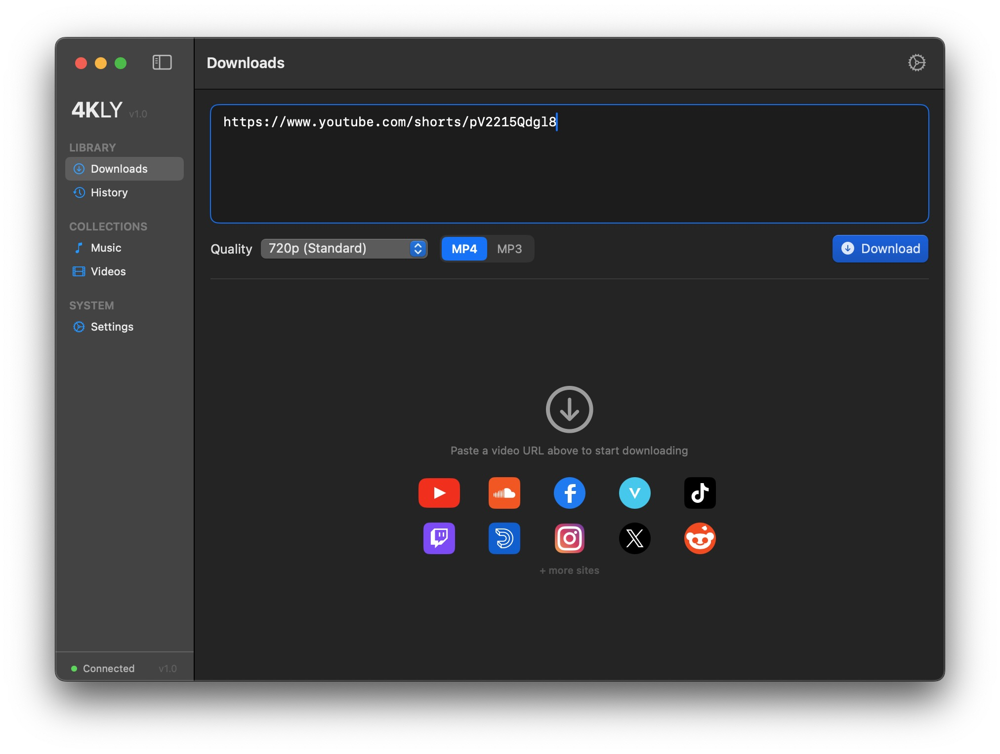
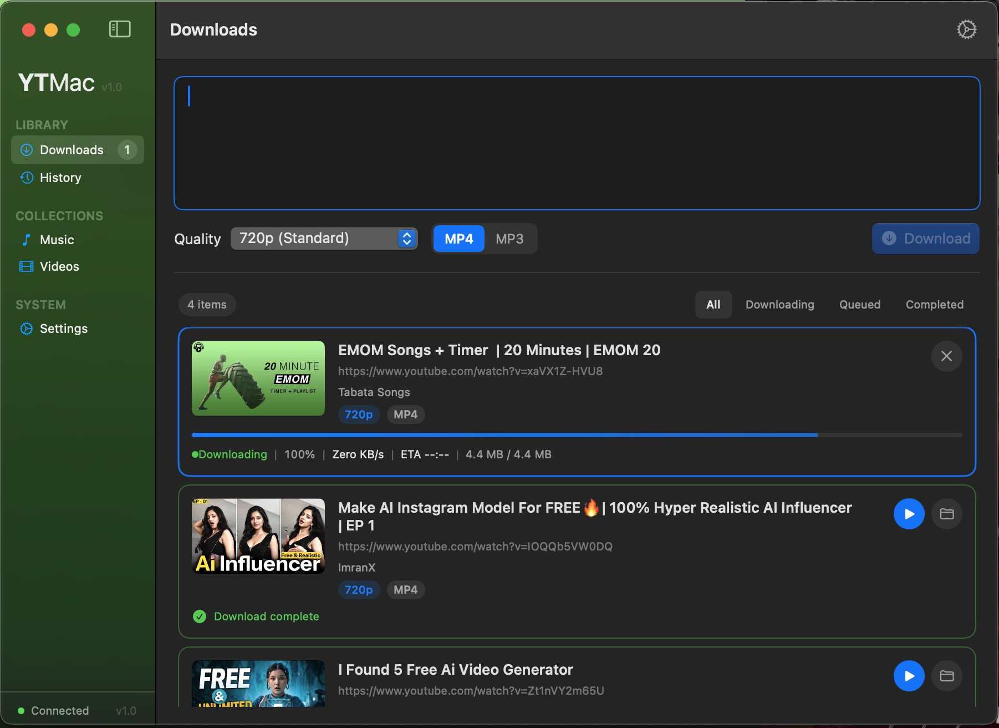
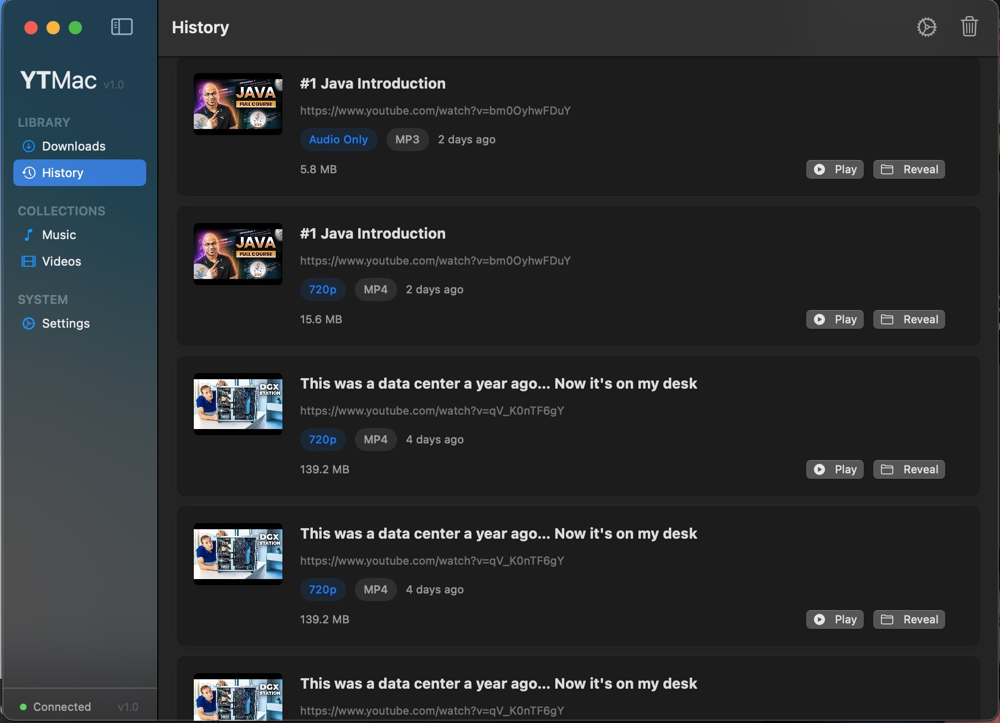

<h1 align="center"><strong>YouTube Video Downloader for </strong>MAC</h1>

  <strong>Free YouTube video downloader for macOS</strong> 
  Beautiful native app. No ads. No tracking. Open source.

  
  
  
  

---

## ⬇️ Download — No Setup Required

  <a href="https://github.com/shivan222/YouTube-downloader/releases/latest"><strong>→ Download 4Kly Free (.DMG)</strong></a> 
  macOS 14+ · Zero Adware

Just download, open the DMG, drag to Applications. Done.

---

## Screenshots

  

  

  

---

## Features

- **Download videos** from YouTube and 1,000+ sites in MP4 (up to 720p)
- **Extract audio** as MP3 with one click
- **Real-time progress** with video thumbnails, title, channel, speed, and ETA
- **Batch downloads** — paste multiple URLs, downloads queue automatically
- **Download history** with Play and Reveal in Finder buttons
- **Auto-updating engine** — yt-dlp updates silently in the background
- **Collections** — Music and Videos auto-sorted by format
- **Dark mode** native macOS design
- **Zero setup** — just install and paste a URL

## How It Works

1. Paste a YouTube URL (or any supported site)
2. Choose quality (720p) and format (MP4 or MP3)
3. Click Download
4. Watch the progress — thumbnail, speed, ETA all shown live
5. Play or Reveal in Finder when complete

**4K**ly automatically downloads and manages [yt-dlp](https://github.com/yt-dlp/yt-dlp) and ffmpeg on first launch. No manual setup needed.

## Supported Sites

YouTube, Vimeo, Twitter/X, Reddit, Instagram, TikTok, Dailymotion, Twitch, SoundCloud, and [1,000+ more](https://github.com/yt-dlp/yt-dlp/blob/master/supportedsites.md) (1,752 extractors total).

## System Requirements

- macOS 14 (Sonoma) or later
- Internet connection
- ~100 MB disk space (app + download engine)

## Want 4K/8K?

**[4Kly Pro →](https://4kly.com)** — one-time $19.99, lifetime license.

- 4K / 8K / 60fps HDR downloads
- Entire playlist downloads
- Audio extraction (MP3/M4A)
- No daily limits

Your purchase supports independent development.

## Privacy

**4K**ly runs entirely on your Mac. No telemetry, no analytics, no data collection. All downloads and history are stored locally.

## Build from Source

> The DMG download above is easier and already notarized. Only build from source if you want to modify the code.

Requires Xcode 15+ and macOS 14+.

## License

[MIT License](LICENSE) — free to use, modify, and distribute.

## Credits

Powered by [yt-dlp](https://github.com/yt-dlp/yt-dlp) and [ffmpeg](https://ffmpeg.org/).

---

Built with ❤️ for macOS

